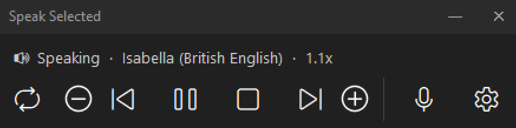
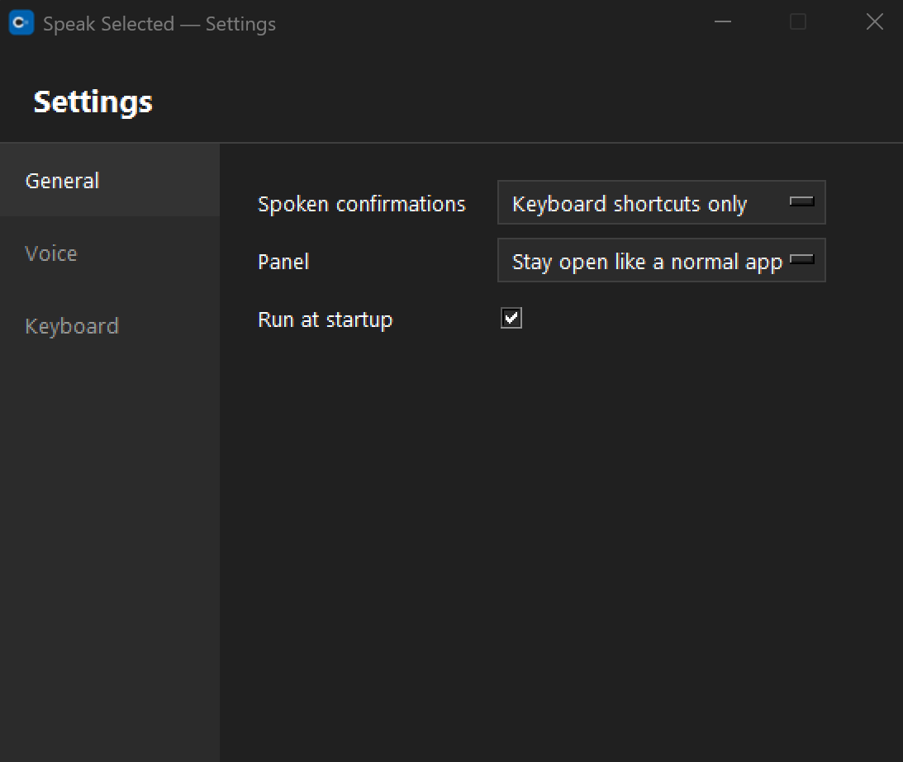

# Speak Selected

**Select any text, anywhere on your screen. Press a shortcut. Hear it read aloud.**
Works in every application, not just the ones that happen to support it.


---

## Why this exists

macOS has had this built in for years: **Speak Selection**. Select text in any app, press a
shortcut, and your Mac reads it back to you. It's one of the most quietly essential
accessibility features Apple ships.

Windows has nothing equivalent. "Read Aloud" in Microsoft Word only works inside Word. Nowhere
else.

This was built by someone with **XLRS (X-linked retinoschisis)**, a genetic low-vision
condition, who relied on Speak Selection daily on a Mac and lost it when a Zoom bug forced a
move to Windows. That gap was the difference between reading comfortably and getting a headache
halfway down the page.

So it got rebuilt properly: system-wide, not an app-by-app patch. The honest summary after using
it for real: **I can actually read stuff again, without the headaches.** That's why this is
public instead of sitting in a personal folder.

## Who this is for

Anyone who finds reading on-screen text tiring or difficult: low vision, dyslexia, eye strain,
or just preferring to listen. Anyone who misses Speak Selection from a Mac. Anyone who wants a
private, system-wide "read this to me" button on Windows.

## What it does

- Select text in any application and press **Ctrl+Alt+Z** to hear it read aloud.
- Full playback control from the keyboard or a small floating panel: pause/resume, stop, skip
  sentence, repeat, speed up or slow down, switch voices mid-sentence.
- **Two voice engines, so it always works.** An enhanced voice (54 voices, 9 languages) is used
  by default. If it's ever missing, Speak Selected falls back to Windows' own built-in voice
  instead of refusing to speak. Pick a specific voice or force an engine in Settings.
- Lives in the system tray, starts at login, shows a short one-time welcome screen with the
  shortcuts.
- A draggable floating panel that remembers where you put it, and opens Settings right next to
  it rather than some arbitrary spot on a second monitor.

<p align="center">
  <br>
  
</p>

## How it works

Pressing the shortcut simulates a copy command, reads the clipboard, speaks it, then restores
whatever was on the clipboard before. Your actual clipboard contents are never disturbed. Speech
comes from [Kokoro](https://huggingface.co/hexgrad/Kokoro-82M), a small open-weight
text-to-speech model that runs on your own CPU, synthesizing one sentence while the next plays
so longer passages read continuously.

Kokoro is preferred but not required. Windows ships its own text-to-speech engine, and Speak
Selected falls back to it automatically if the Kokoro model is missing or fails to load.

Clipboard simulation was a deliberate choice over reading an app's accessibility tree directly.
Windows has several incompatible accessibility APIs (UI Automation, MSAA, IAccessible2), and
none of them is implemented consistently across every app. Simulated copy works almost
everywhere, because almost anything that lets you select text also lets you copy it.

## Privacy

- Nothing is ever sent anywhere. No cloud service, no account, no internet connection.
- The voice model runs entirely on your machine. Selected text never leaves your computer.
- No telemetry, no analytics, no crash reporting. Errors are logged to a plain text file on
  your own disk, never transmitted.

## Install

**[⬇ Download SpeakSelectedSetup.exe](https://github.com/JoshABrasso/Speak-Selection-Accessibility-Tool/releases/latest/download/SpeakSelectedSetup.exe)**
— always the latest release.

1. Run it: a normal installer wizard, no administrator rights needed, fully self-contained. (The
   raw [`SpeakSelected.msi`](../../releases) is also on the [Releases](../../releases) page if
   you want that instead.)
2. Windows may show a "Windows protected your PC" screen the first time. That's normal for
   software without a paid code-signing certificate. Click **More info**, then **Run anyway**.
3. A short welcome screen explains the shortcuts. No setup, no accounts.

## Using it

**Reading**
| Shortcut | Does |
|---|---|
| `Ctrl+Alt+Z` | Speak the selected text |
| `Ctrl+Alt+X` | Pause / resume |
| `Ctrl+Alt+C` | Stop |

**Navigating what's being read**
| Shortcut | Does |
|---|---|
| `Ctrl+Alt+Home` | Repeat the current selection from the start |
| `Ctrl+Alt+PageUp` | Previous sentence |
| `Ctrl+Alt+PageDown` | Next sentence |

**Voice and speed**
| Shortcut | Does |
|---|---|
| `Ctrl+Alt+N` | Cycle voice |
| `Ctrl+Alt+]` | Speed up |
| `Ctrl+Alt+[` | Slow down |
| `Ctrl+Alt+,` | Open Settings (pick a specific language and voice) |

Every shortcut also has a matching button on the floating panel and the tray menu. Nothing here
requires memorizing keys.

These are defaults, not fixed — change any of them in Settings → **Keyboard Shortcuts**, since
Ctrl+Alt+anything might already be used by something else on your setup.

## Known limitations

- Clipboard-copy works almost everywhere, but not in apps that deliberately disable copying
  (some DRM-protected readers, for instance).
- The non-English enhanced voices depend on `espeak-ng`'s phonemization quality for that
  language. English, Spanish, French, and Italian are strongest; Japanese and Mandarin are the
  least refined.
- The Windows built-in fallback voice's quality and selection depend on what's installed on
  your machine. It's there so the app always works, not to match the enhanced voice.
- This is a first public release. Open an [issue](../../issues) if something breaks.

## Building from source

Requires Python 3.12+, and the [WiX Toolset v5+](https://wixtoolset.org/) if you want to build
the installer (not required just to run it from source).

```
git clone <this repo>
cd <the folder you just cloned into>
python -m venv venv
venv\Scripts\pip install -r requirements.txt
```

Download the voice model (not included in this repo, about 353MB) from the
[kokoro-onnx releases page](https://github.com/thewh1teagle/kokoro-onnx/releases): get
`kokoro-v1.0.onnx` and `voices-v1.0.bin` and place both in `models\`.

Run it directly:

```
venv\Scripts\python speak_selected.py
```

Or build the standalone installer:

```
venv\Scripts\python -m PyInstaller --name SpeakSelected --onedir --windowed --icon app.ico ^
  --collect-all kokoro_onnx --collect-all onnxruntime --collect-all phonemizer ^
  --collect-all espeakng_loader --collect-all sounddevice --collect-all pystray ^
  --hidden-import win32timezone speak_selected.py

:: copy models\*.onnx, models\*.bin, and app.ico into dist\SpeakSelected\ first

wix build Installer\SpeakSelected.wxs -d PayloadDir="dist\SpeakSelected" -out Installer\SpeakSelected.msi
```

## Feedback and issues

Bug reports, questions, and suggestions are welcome: open an [issue](../../issues). Maintained
by someone who uses it every day, not a support team, so please be patient.

## Credits

- [Kokoro](https://huggingface.co/hexgrad/Kokoro-82M) (Apache-2.0) — the enhanced voice model
- [kokoro-onnx](https://github.com/thewh1teagle/kokoro-onnx) (MIT) — the inference engine
- [espeak-ng](https://github.com/espeak-ng/espeak-ng) and
  [phonemizer](https://github.com/bootphon/phonemizer) (both GPL-3.0) — turn text into the
  phonemes Kokoro speaks, and the reason this project is GPL-3.0
- Windows' own built-in **SAPI5** text-to-speech, the always-available fallback voice, accessed
  via [pywin32](https://github.com/mhammond/pywin32) (PSF license), which also powers clipboard
  access and global shortcuts throughout the app
- Apple's **Speak Selection**, for being the feature this was always meant to replace

## License

GPL-3.0 — see [LICENSE](LICENSE). Free to use, study, modify, and share.
